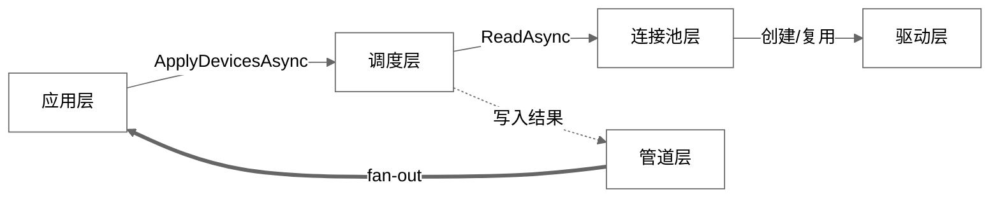
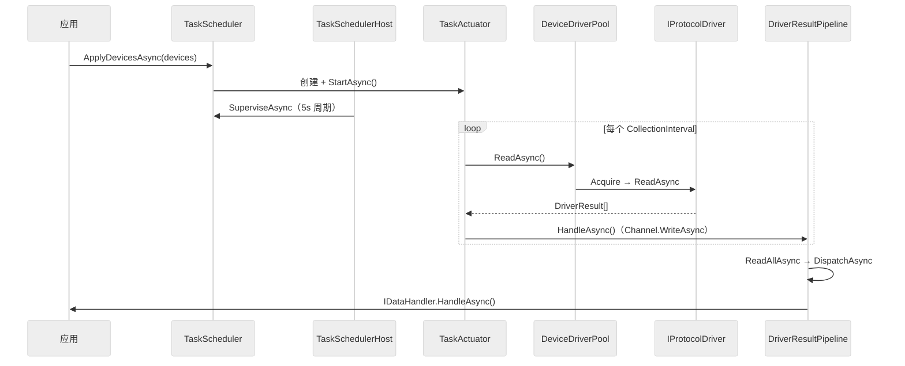
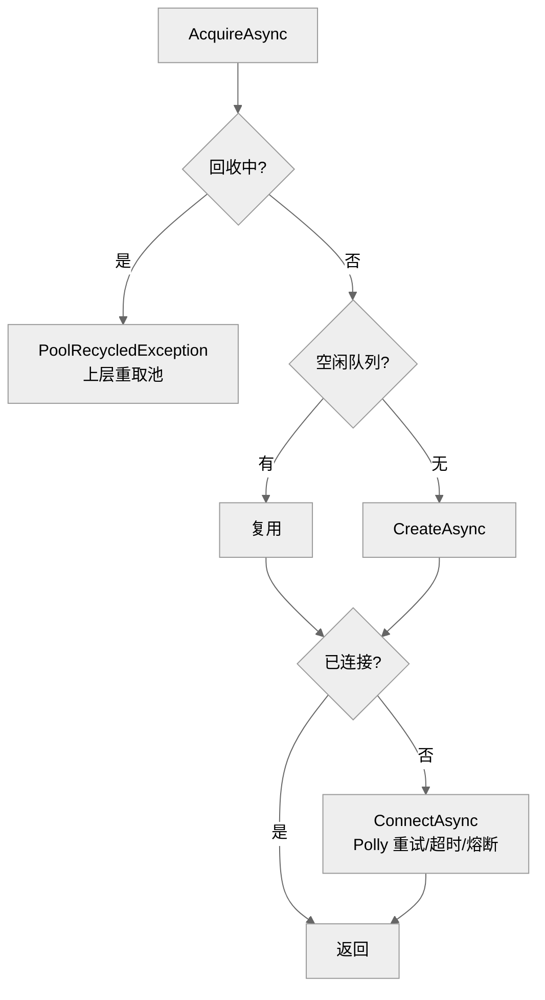

# 开发文档

面向贡献者与维护者：架构、运行时、驱动开发、批量读设计、测试策略与已知限制。

> 使用者文档见 [README.md](./README.md)；AI 代理规则见 [AGENTS.md](./AGENTS.md)；库与 SCADA 的职责边界见 [docs/SCOPE.md](./docs/SCOPE.md)；发布与 tag 规范见 [docs/RELEASING.md](./docs/RELEASING.md)；当前评估见 [docs/ASSESSMENT-2026-11-03.md](./docs/ASSESSMENT-2026-11-03.md)，历史快照见 [docs/ASSESSMENT-2026-11.md](./docs/ASSESSMENT-2026-11.md)。

## 架构总览



| 层 | 核心类 | 职责 |
|------|------|------|
| 应用层 | `IDeviceScheduler`、`IDataHandler`、`IDeviceAccessor` | 下发配置、接收数据、主动读写 |
| 调度层 | `TaskScheduler`、`TaskActuator`、`TaskSchedulerHost` | 差量 reconcile、采集循环、失败监督 |
| 连接池层 | `DeviceDriverPool`、`DeviceSharedPool` | 连接复用、Polly 弹性、空闲回收 |
| 驱动层 | `IProtocolDriver`、`IPushProtocolDriver` | 协议通信与编解码 |
| 管道层 | `DriverResultPipeline`、`PipelineHost` | Channel 消费、fan-out、背压 |
| 扩展 | `PlcLibrary.Monitor` | 最新值缓存 + 变化订阅（`IDataHandler`） |

分层原则：上层依赖下层，下层不感知上层；`Channel<DriverResult>` 解耦调度与管道。`TaskScheduler`、`DriverResultPipeline`、`PlcMonitor` 是纯业务类，`*Host : BackgroundService` 只接管宿主生命周期。

## 运行时序列



## 调度层

`TaskScheduler` 实现 `IDeviceScheduler`，按 `Id` 做差量 reconcile：

- 新增设备 → 创建 `TaskActuator` 并启动
- 配置变更（协议/连接串/超时/采集周期/点位集合）→ 停止并重建
- 设备移除/禁用 → 停止并释放
- 非法配置/未注册协议/重复 Id → 跳过并记录日志
- `_applyLock`（`SemaphoreSlim`）串行化所有 apply/重启操作

`TaskActuator` 持有采集器与 `CancellationTokenSource`：

- `ExecuteAsync` 捕获**所有**异常，记录到 `LastError`，循环结束但不产生未观察任务异常
- `StopAsync` 不向调用方抛异常；`IsRunning` 反映循环是否仍在运行
- `GetDeviceHealthAsync` 返回 `IsRunning=false` + `LastError`

`TaskSchedulerHost` 承载监督循环：

```csharp
protected override Task ExecuteAsync(CancellationToken ct) => _scheduler.SuperviseAsync(ct);

public override async Task StopAsync(CancellationToken ct)
{
    await base.StopAsync(ct);                  // 先取消并等待监督循环
    await _scheduler.StopSchedulerAsync();     // 再停止执行器
}
```

监督策略：每 `SupervisionInterval`（默认 5s）扫描，`IsRunning=false` 或**心跳超时**的执行器按指数退避（周期 × 2^n，最长 60s）重建采集器与驱动，成功后计数清零。轮询采集器内部吞异常、通常不会退出；推送驱动（OPC UA）连接失败会让循环提前结束。

- **心跳**：`PollingCollector` 每个采集周期结束（成功或失败）刷新；`PushCollector` 每次成功分发刷新，并由 30s 健康检查循环在无数据变化时继续刷新。轮询阈值 `max(4 × CollectionInterval, 30s)`，推送阈值 5 分钟；`TaskActuator.IsStalled` 由监督循环检查，健康状态返回 `Faulted`。推送驱动状态变为 `Faulted`/`Disconnected` 时采集器主动结束，交由监督循环重建
- **有界停止**：`TaskActuator.StopAsync` 等待循环退出（默认 10s），超时后强制释放采集器（默认再等 5s）并放弃旧循环；监督/停机不会因一个不响应取消的采集循环永久挂起
- **监督自愈**：`SuperviseAsync` 对单轮异常记录日志后继续，不会因一次异常退出监督循环

## 连接池层

`DeviceDriverPool` 实现 `IDeviceAccessor`，按 `协议|连接串` 维护 `DeviceSharedPool`：

| 组件 | 作用 |
|------|------|
| `SemaphoreSlim` | 限制并发连接数（`MaxConnectionsPerDevice`） |
| `ConcurrentQueue<IProtocolDriver>` | 空闲驱动队列（先取后建） |
| `ResiliencePipeline` | 连接级 Polly 管线（重试 + 超时 + 断路器），**由池自持** |

### 获取与归还



- 借用成功 `_inUse++`；归还 `_inUse--`，Faulted 驱动直接释放
- 连接失败/超时由池管线重试；断路器打开时快速失败
- `Return` 时若池已被回收，直接释放驱动，不触碰已释放的信号量
- **硬超时**：IO 在 Polly 超时之外再等 2s（`HardTimeoutGrace`），连接在 `ConnectionTimeout` 之外再等 2s；底层调用不响应取消令牌时也会返回，驱动按 `discard` 丢弃，不回到 idle 队列
- **归还顺序**：正常归还先入 idle 队列、再减少 `_inUse`，避免清理线程在“已减计数、尚未入队”窗口销毁池导致驱动泄漏；`DisposeAsync` 与 `Return` 通过 `_gate` 协调
- **有界释放**：`DisposeAsync` 最多等 5s；超时后记录日志并放弃等待，避免一个坏驱动的 Dispose 拖住整个归还/清理流程

### 生命周期与回收

- **池持有管线**：`DeviceSharedPool` 构造时自建 Polly 管线，池销毁即回收；不存在全局注册表或跨设备共享状态
- **空闲回收**：`DeviceDriverPool` 用 `PeriodicTimer`（60s）扫描；池空置超过 `PoolIdleTimeout` 且 `_inUse == 0` 时，先 `TryBeginRecycle` 原子标记，再移除并销毁。并发借用会得到 `PoolRecycledException` 并由 `DeviceDriverPool.AcquireAsync` 重取池重试，避免与已释放信号量竞争
- **清理异常**：按周期记录并重试，不终止清理循环；停机时等待清理循环退出

### Push 双轨设计

轮询驱动按次借用连接。`IPushProtocolDriver`（OPC UA）的订阅状态（MonitoredItem、发布队列）绑定驱动实例，池化会破坏订阅语义，因此 `PushCollector` 为每台设备创建独立驱动与连接级管线，与轮询池并存、互不干扰。推送采集器异常结束由调度器监督循环重建。

## 管道层

`DriverResultPipeline` 持有有界 `Channel<DriverResult>`（`Capacity`），`PipelineHost` 驱动消费：

- `HandleAsync`：先尝试写入有界队列；超过 `EnqueueTimeout`（默认 5s）仍无空间则丢弃该点并计入 `plc.pipeline.dropped`，避免采集循环被反压永久卡住
- `ConsumeAsync`：`ReadAllAsync` 串行消费，逐条 `DispatchAsync`
- 分发：单 handler 直接调用（快路径）；多 handler 按 `MaxHandlerParallelism` 并行；每个 handler 的 `HandlerTimeout` 是**硬上限**（`WaitAsync`），即使忽略取消令牌也不会卡住分发；超时/异常只记录不干扰其它 handler
- 订阅：`IDataPipeline.ReadAsync` 为每个订阅者建容量 1000 的通道，满时 `DropOldest`（不逐点计数；`plc.pipeline.dropped` 只统计写入队列超时）
- 停机：`StopConsuming` 完成 Writer，`DisposeResources` 完成所有订阅通道

## 编写自定义驱动

### 1. 连接字符串绑定

配置使用 `record` + `ConnectionStringBinder`（基于 `IConfiguration` 绑定，大小写不敏感）：

```csharp
public sealed record MyDriverConfig
{
    public string Host { get; init; } = "127.0.0.1";
    public int Port { get; init; } = 5000;
    public int Timeout { get; init; } = 3000;

    public static MyDriverConfig Parse(string connectionString)
        => ConnectionStringBinder.Bind<MyDriverConfig>(connectionString);
}
```

> 绑定器默认校验未知键：键名必须是配置类型的公开属性名，或驱动显式声明的别名（如 S7 `cpu`）；拼写错误在构造驱动配置时直接抛出。值支持单/双引号包裹以保留 `;`、冒号和首尾空格；引号内同种引号双写转义。

### 2. 数据类型

`DataTypeMapper.TryResolve` 解析简写/IEC 别名/`System.*` 全名；未知类型返回 `false`，驱动应返回 `BadConfigError` 而不是回退 `int`。`Resolve` 仅用于兼容既有默认行为（空值 → `int`）。

### 3. 实现 `ProtocolDriverBase<TClient>`（或 `IProtocolDriver`）

```csharp
[ProtocolDriverName("MyProtocol")]
public sealed class MyDriver(ILogger<MyDriver> logger, DeviceConfiguration device)
    : ProtocolDriverBase<MyClient>
{
    public override async Task ConnectAsync(CancellationToken ct = default)
    {
        await DisconnectAsync(ct);
        SetState(null, DriverStatus.Connecting);
        var client = new MyClient(...);
        await client.ConnectAsync(ct);
        SetState(client, DriverStatus.Connected);
    }

    public override Task DisconnectAsync(CancellationToken ct = default)
    {
        var old = DetachClient();
        old?.Dispose();
        return Task.CompletedTask;
    }

    public override Task<DriverResult[]> ReadAsync(TagPointConfiguration[] points, CancellationToken ct = default)
    {
        var client = GetClientOrThrow("MyProtocol");
        // ...
    }

    public override Task<DriverResult[]> WriteAsync(
        IReadOnlyDictionary<TagPointConfiguration, object> values, CancellationToken ct = default)
    {
        var client = GetClientOrThrow("MyProtocol");
        // ...
    }
}
```

基类统一：`DriverStatus`/状态锁、`GetClientOrThrow`、`DetachClient`、`SetState`、`MarkFaultedIfTransport`、`TryReconnectAsync`（失败返回 false + `Faulted`）、`DisposeAsync`（调用 Disconnect）。协议差异只留在 Connect/Disconnect/Read/Write。

约定：

- `ReadAsync` 结果数组与输入点位**一一对应**；单点失败用 `DriverResult.Bad`，不要抛异常
- 传输级故障（socket/IO/超时）置 `DriverStatus.Faulted`（基类 `MarkFaultedIfTransport` 已封装），连接池据此丢弃重建
- 传输异常可抛出，由池的 IO 级重试处理；业务/点位错误返回 Bad
- `ConnectAsync` 失败置 `Faulted` 并抛出；`TryReconnectAsync` 由基类统一，失败返回 false（取消除外）
- 释放所有 socket/客户端；`DisposeAsync` 先断开再释放；需要额外释放/日志时覆写基类模板
- 分页/批量读取时按组隔离错误；未支持的类型返回 `BadConfigError`
- 可选实现 `ITagBrowser`（浏览直接子节点）；`DeviceDriverPool` 通过 `IDeviceBrowser` 统一借用/归还驱动

### 4. 注册

```csharp
services.AddPlcLibrary().AddDriver<MyDriver>();
```

`AddDriver<T>` 读取 `[ProtocolDriverName]`，按 `IPushProtocolDriver` 自动标记 `SupportsPush`。`Protocol` 必须精确匹配。

### 5. 测试

新增驱动必须配套**离线协议回环**（本机起真实协议服务端，动态端口，见「测试策略」），至少覆盖：

- 连接/断开/重连与 `Faulted` 状态
- 读取：类型、顺序、字节序、越界/非法地址隔离
- 写入：到达服务端并回读一致
- 批量请求次数（用服务端计数或抓帧断言）
- 错误码 → `QualityCode` 映射

## 弹性与超时

| 级别 | 作用域 | 策略 | 位置 |
|---|---|---|---|
| 连接级 | `ConnectAsync`/`TryReconnectAsync` | 重试 + 超时 + 断路器（每池） | `DeviceSharedPool` |
| IO 级 | `ReadAsync`/`WriteAsync` | 重试 + 超时 + 断路器（每设备） | `DeviceDriverPool` |

- IO 级只对抛出的异常重试；Bad 结果不触发。IO 断路器按设备键独立统计“重试后仍失败”的最终结果，超时也计入失败
- 驱动应把配置的 `timeout` 应用到单次操作：AB 用链接 CTS 包住每次调用；Modbus TCP 用于连接建立与收发；S7/OPC UA 传给底层客户端
- `DeviceConfiguration.ConnectionTimeout` 是**池借用超时**，不是协议连接超时

## 可观测性埋点

| Span | 位置 | 标签 |
|---|---|---|
| `PlcLibrary.ReadAsync` | `DeviceDriverPool.ReadAsync` | device.id/device.protocol/point.count |
| `PlcLibrary.WriteAsync` | `DeviceDriverPool.WriteAsync` | device.id/device.protocol/point.count |
| `PlcLibrary.Acquire` | `DeviceSharedPool.AcquireAsync` | device.id/device.protocol |
| `PlcLibrary.BrowseAsync` | `DeviceDriverPool.BrowseAsync` | device.id/device.protocol |
| `PlcLibrary.Dispatch` | `DriverResultPipeline.DispatchAsync` | device.id/tag.id/status |

指标清单与 PromQL 示例见 [README](./README.md#可观测性)；埋点原则：

- 只在池/管道边界记录，不在驱动热路径打 Info 日志
- 指标标签保持低基数（设备/协议/质量），不要放地址/TagId
- 新增指标同步更新 README 表格；Bad 点用 `plc.points.bad`（不再只看异常计数），重连用 `plc.reconnects` / `plc.reconnect.failures`

## 批量读设计

| 驱动 | 批量方式 | 失败策略 |
|---|---|---|
| Modbus | 连续地址合并 + PDU 上限切分 | 组失败 → 该组 Bad；传输级置 Faulted |
| S7 | `ReadMultipleVarsAsync` + 逐点回退；`DataType` 可覆盖地址推断 | 传输级失败 → 整批 Bad；非传输失败 → 逐点回退 |
| AllenBradley | `ReadMultipleAsync` 原始字节 + CIP 小端解码 | 批量失败 → 逐点回退；string 逐点 |
| BACnet | `ReadPropertyMultipleAsync` 按对象分组 | 整批失败 → 全部 Bad；传输级置 Faulted |
| Mitsubishi | 同设备/同类型连续地址合并为 Snet 数组读；字软元件 bool 按字数组 + 取位；位软元件逐点 | 组失败 → 该组 Bad；传输级置 Faulted |
| Omron | 连续字合并为 `Read`、连续位合并为 `ReadBit`（空隙容忍 64 位，上限 480 字/256 位） | 组失败 → 该组 Bad；传输级置 Faulted |

原则：批量读不得引入数据正确性风险。解码必须有可验证依据（NModbus 数组、CIP 小端规范、Snet 数组类型、FINS `Transform`）；无法验证的字节序优化宁可推迟。

## 测试策略

### 命令

```bash
dotnet build PlcLibrary.slnx -c Debug
dotnet test PlcLibrary.Tests/PlcLibrary.Tests.csproj -c Debug

# 单协议
dotnet test PlcLibrary.Tests/PlcLibrary.Tests.csproj -c Debug --filter "FullyQualifiedName~S7DriverSimulatorTests"
```

### 离线服务端

| 协议 | 服务端 | 位置 |
|---|---|---|
| Modbus TCP/UDP | NModbus 从站 | `Simulators/ModbusSlaveServer`（Monitor 测试内）/ 测试内联 |
| S7 | 自建 S7comm 从站 | `Simulators/S7SimServer.cs` |
| Omron FINS | `NewLife.Omron.FinsServer` | 测试内联 + `Simulators/FinsFrameCounterProxy.cs` |
| Mitsubishi MC | 自建 MC 3E 从站 | `Simulators/McProtocolSimServer.cs` |
| Allen-Bradley | 自建 EtherNet/IP+CIP 从站 | `Simulators/EtherNetIpSimServer.cs` |
| BACnet/IP | `System.IO.BACnet.BacnetClient` 服务端模式 | `Simulators/BacnetSimServer.cs` |
| OPC UA | `Opc.Ua.Server` 标准节点空间 | `Simulators/OpcUaTestServer.cs` |

OPC UA 测试包 `OPCFoundation.NetStandard.Opc.Ua.Server` 为 **test-only**，生产包不引入服务端依赖。所有服务端使用动态端口、可 `IAsyncDisposable` 清理，测试可并行。

### 覆盖重点

- 连接/断开/重连、`Faulted` 与池重建
- 批量请求次数、错误隔离、字节序/类型
- 推送订阅回调、监控去重、管道背压
- 调度 reconcile、监督重启、停机安全
- 配置/池/管道的 Options 校验

### 无法离线验证

- 串口物理层（RTU/ASCII 帧）：需真实/虚拟串口对（com0com）
- OPC UA 自定义 NodeManager 的可写节点语义
- 真实 PLC 的字节序、位地址、厂商扩展（建议上线前真机联调）
- 长时间浸泡/混沌（当前仅并发、背压、10k 管道压力用例）

## 已知限制与技术债

> 详细证据、严重度与复现见 [评估报告 §5](./docs/ASSESSMENT-2026-11-03.md#5-缺陷与风险清单)；以下为当前仍需注意的行为。

| 项 | 现状 | 影响 |
|---|---|---|
| Mitsubishi 批量写 | 底层只返回整体结果 | 部分点失败时整批 Bad，重试需谨慎（非幂等） |
| handler 同步阻塞 | `HandleAsync` 在返回 `ValueTask` 之前同步阻塞仍会占住管道消费者；`EnqueueTimeout` 只保护采集侧不挂起 | 这种 handler 应改为异步；否则数据会被丢弃而不是被处理 |
| 驱动 Dispose/Disconnect 不响应 | 池等待有界（连接 5s、归还后台），超时后放弃等待 | 底层 socket 可能仍由运行库持有，直到其自身超时 |

## 默认值与常量

只隔离“可能变化 / 测试与生产可能不一致”的值；固定且只使用一次的标识直接写在原处，不为了统一而制造常量层。

| 类型 | 做法 | 示例 |
|---|---|---|
| 配置默认值 | 直接写在各自的 `*DriverConfig` / `*Options` 属性上（只有多处共享时才用常量） | 端口、超时、host、PKI 路径、端点、默认 `CpuType`、池/管道/监控默认值；测试通过连接串/Options 覆盖 |
| 单类算法常量 | 使用它的类内 `private const` | PDU/批量上限、订阅计数、清理/监督周期、通道容量、退避指数 |
| 共享且会变化的标识 | `PlcMetrics.Meter`（名称 + 程序集版本） | `ActivitySource` 直接复用 `Meter.Name`/`Meter.Version`，不再单独维护常量类 |
| 固定且单次使用 | 直接内联 | `[ProtocolDriverName("S7")]`、OPC UA 应用名/证书主题、Mitsubishi `protocoltype`、AB CIP 类型码（驱动内 private 方法） |

| 项目 | 配置默认值位置 |
|---|---|
| `PlcLibrary` | `PoolOptions`、`PipelineOptions`、`MonitorOptions`、`DeviceConfiguration` |
| `PlcLibrary.Modbus` | `ModbusDriverConfig` |
| `PlcLibrary.S7` | `S7DriverConfig` |
| `PlcLibrary.OpcUa` | `OpcUaDriverConfig` |
| `PlcLibrary.Mitsubishi` | `MitsubishiDriverConfig` |
| `PlcLibrary.Omron` | `OmronDriverConfig` |
| `PlcLibrary.AllenBradley` | `AllenBradleyDriverConfig` |
| `PlcLibrary.Bacnet` | `BacnetDriverConfig` |

规则：

- 协议名等固定契约直接写在 `[ProtocolDriverName(...)]`；只有两处以上共享且可能变化时才上提。
- 测试与生产不一致的值（端口、超时、PKI 目录、端点）必须能通过连接串或 Options 覆盖，不写死在驱动逻辑里。
- 配置默认值改动同步 README 对应表格；单类算法常量只改类内 `const`。
- 新增共享常量放 `internal` 类型，避免固化为公开 API。

## 文档维护约定

- **README**：使用者视角（配置、API、行为）；不要写内部实现细节
- **DEVELOPMENT**：架构、设计决策、测试策略、已知限制；实现变更同步更新
- **AGENTS**：代理规则与仓库地图，不复制大段内容，只链接
- **CHANGELOG**：每次发布记录新增/修复/不兼容变更；测试数量以实际运行结果为准
- **ASSESSMENT**：带日期的快照，不随代码更新；新评估另建文件，旧文件保留并标注状态
- 同一事实只写一处，其它文档链接过去；避免"当前/最新"等易过期措辞，改为具体版本或日期
